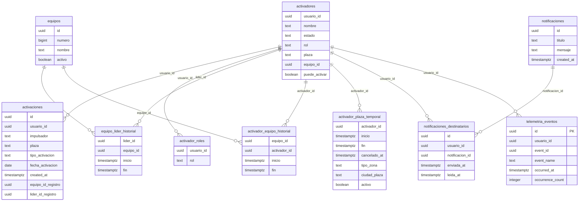

# Esquema de base de datos de Impulsa360

Fecha de corte: `2026-10-19`

## 0. Alcance, método y procedencia

Este documento describe el esquema que puede comprobarse en el repositorio local de Impulsa360 y lo separa de cualquier afirmación sobre la base desplegada. No se consultaron registros operativos, datos personales, fotografías ni credenciales. No se modificó código ni base de datos, no se ejecutaron migraciones ni se realizaron commits.

Convenciones usadas en todo el documento:

| Marca | Significado |
|---|---|
| `[REPO]` | Hecho comprobado en migraciones, scripts SQL, código de la app o documentación del repositorio. |
| `[REMOTO]` | Hecho comprobado contra PostgreSQL remoto. **No hay verificaciones de este tipo en este documento.** |
| `[INFERIDO]` | Dato deducido del uso del esquema en el código o en las RPC, sin DDL local que lo declare. |
| `[FALTANTE]` | Metadato no disponible en el repositorio ni verificable en remoto. |

Los tipos anotados como “(por uso)” son `[INFERIDO]`: se deducen del cliente o de las RPC, no de un DDL local.

### 0.1 Acceso remoto disponible

No se pudo obtener el esquema efectivo de PostgreSQL remoto.

- El repositorio contiene un proyecto Supabase vinculado en `supabase/.temp/`, pero no incluye el CLI de Supabase instalado.
- El entorno no tenía `SUPABASE_ACCESS_TOKEN`, `SUPABASE_DB_PASSWORD`, `DATABASE_URL`, `PGURL` ni `SUPABASE_SERVICE_ROLE_KEY`.
- Se intentó consultar únicamente el documento de metadatos de PostgREST con la clave anónima disponible en `.env`. La respuesta fue `401` con el mensaje de que ese endpoint solo admite `service_role`. No se leyó ningún registro.
- No se dispone de una conexión autorizada de solo lectura a PostgreSQL para consultar `pg_catalog` o `information_schema`.
- Los valores de URL, claves, tokens y cadenas de conexión no se transcriben en este documento.

Por lo anterior, **no existe comparación local-contra-remoto** en este informe. La sección 8 documenta esa ausencia y los metadatos que faltan.

### 0.2 Fuentes revisadas

- `supabase/migrations/*.sql` (12 archivos).
- `supabase/manual/*.sql` (6 archivos).
- `App.js`, `components/AuthScreen.js`, `components/FormularioActivacion.js`, `components/FormulariosPorImpulsador.js`, `components/ControlActivadores.js`.
- `lib/notificaciones.js`, `lib/plazasTemporales.js`, `lib/elegibilidadReactivacion.js`, `lib/telemetry.js`.
- `docs/auditoria-documental-app-movil.md`, `HANDOFF_2026-03-01.md`, `docs/cliente/04_documentacion_tecnica.md`.
- `supabase/.temp/` únicamente para confirmar que existe un proyecto vinculado; no se usaron sus valores como fuente de esquema.

### 0.3 Advertencia central

El repositorio **no contiene el DDL base** de `activaciones`, `activadores`, `activador_roles`, `equipos`, los historiales, `notificaciones` ni `notificaciones_destinatarios`. Solo contiene:

- `ALTER TABLE` parciales;
- índices;
- funciones RPC;
- políticas RLS de Storage y de `activador_plaza_temporal`;
- la definición completa de `telemetria_eventos`.

En consecuencia, para la mayoría de las tablas se conocen nombres de columnas usados por la app y por las RPC, pero **no** sus tipos, nulabilidad, PK, FK, UNIQUE ni CHECK efectivos. Esos datos se marcan como `[FALTANTE]`.

---

## 1. Inventario de tablas y columnas

### 1.1 Resumen de tablas

| Tabla | Propósito observado | Evidencia | DDL base en repo |
|---|---|---|---|
| `public.activaciones` | Registro principal de activaciones. | `[REPO]` `App.js`, RPC de control, `FormulariosPorImpulsador.js`, `ControlActivadores.js` | No |
| `public.activadores` | Perfil, estado, rol, plaza, equipo y permiso `puede_activar`. | `[REPO]` `App.js`, `AuthScreen.js`, RPC, migración `202608080001` | No |
| `public.activador_roles` | Roles adicionales por usuario. | `[REPO]` `App.js`, `AuthScreen.js`, RPC `202610140001` | No |
| `public.equipos` | Equipos, número, nombre y estado activo. | `[REPO]` RPC de control, política de Storage | No |
| `public.equipo_lider_historial` | Vigencia temporal de un líder por equipo. | `[REPO]` RPC de control, política de Storage | No |
| `public.activador_equipo_historial` | Vigencia temporal de un activador por equipo. | `[REPO]` RPC de control, política de Storage | No |
| `public.activador_plaza_temporal` | Plazas o zonas temporales asignadas a un activador. | `[REPO]` `lib/plazasTemporales.js`, migraciones `202608310002` y `202608310004` | Parcial |
| `public.notificaciones` | Contenido de notificaciones. | `[REPO]` `lib/notificaciones.js` | No |
| `public.notificaciones_destinatarios` | Destinatarios, envío y lectura. | `[REPO]` `lib/notificaciones.js`, `App.js` (Realtime) | No |
| `public.telemetria_eventos` | Eventos técnicos de diagnóstico. | `[REPO]` migraciones `202610050001` y `202610060001` | Sí |

Referencias que no se incluyen como tablas del esquema:

- `public.ubicaciones`: aparece mencionada en `HANDOFF_2026-03-01.md` por alertas históricas de Security Advisor, pero no tiene DDL, columnas ni uso en la app dentro del repositorio. No se incluye en el ERD.
- El portal web no está en este repositorio. No se puede afirmar qué tablas, columnas, RPC o políticas comparte.

### 1.2 `public.activaciones`

Columnas identificadas por el payload que la app envía, por los resultados de las RPC y por las consultas de lectura.

| Columna | Tipo local | Restricciones locales | Evidencia / uso |
|---|---|---|---|
| `id` | `uuid` | `[FALTANTE]`. El cliente hace `upsert` con `onConflict: 'id'`, por lo que el remoto necesita una PK o UNIQUE sobre esta columna. | `[REPO]` `App.js:1075`; retorno de `control_activaciones_detalle` |
| `usuario_id` | `uuid` | `[FALTANTE]` | `[REPO]` RPC y filtros de la app; identidad del activador |
| `impulsador` | `text (por uso)` | `[FALTANTE]` | `[REPO]` `App.js` agrega el campo al payload |
| `plaza` | `text` | `[FALTANTE]` | `[REPO]` retorno de RPC; `docs/cliente/04_documentacion_tecnica.md` |
| `tipo_activacion` | `text` | `[FALTANTE]` | `[REPO]` retorno de RPC y código de la app |
| `base_activacion` | `text (por uso)` | `[FALTANTE]` | `[REPO]` payload permitido |
| `es_reactivacion` | `boolean (por uso)` | `[FALTANTE]` | `[REPO]` payload permitido |
| `reactivacion_comercio` | `boolean (por uso)` | `[FALTANTE]` | `[REPO]` payload permitido y saneamiento en `App.js` |
| `fecha_activacion` | `date` | `[FALTANTE]` | `[REPO]` retorno de RPC; orden y filtros de la app |
| `created_at` | `timestamptz` | `[FALTANTE]`. La app no lo envía; se asume valor del servidor. | `[REPO]` retorno de RPC; `HANDOFF_2026-03-01.md` |
| `nombres_cliente` | `text` | `[FALTANTE]` | `[REPO]` retorno de RPC |
| `apellidos_cliente` | `text` | `[FALTANTE]` | `[REPO]` retorno de RPC |
| `ci_cliente` | `text (por uso)` | `[FALTANTE]` | `[REPO]` payload y RPC de elegibilidad |
| `telefono_cliente` | `text (por uso)` | `[FALTANTE]` | `[REPO]` payload y RPC de elegibilidad |
| `email_cliente` | `text (por uso)` | `[FALTANTE]` | `[REPO]` payload permitido |
| `descargo_app` | `boolean (por uso)` | `[FALTANTE]` | `[REPO]` payload permitido |
| `registro` | `boolean (por uso)` | `[FALTANTE]` | `[REPO]` payload permitido |
| `cash_in` | `boolean (por uso)` | `[FALTANTE]` | `[REPO]` payload permitido |
| `cash_out` | `boolean (por uso)` | `[FALTANTE]` | `[REPO]` payload permitido |
| `p2p` | `boolean (por uso)` | `[FALTANTE]` | `[REPO]` payload permitido |
| `qr_fisico` | `boolean (por uso)` | `[FALTANTE]` | `[REPO]` payload permitido |
| `hubo_error` | `boolean (por uso)` | `[FALTANTE]` | `[REPO]` payload permitido |
| `descripcion_error` | `text (por uso)` | `[FALTANTE]` | `[REPO]` payload permitido |
| `tipo_error` | `text (por uso)` | `[FALTANTE]` | `[REPO]` payload permitido |
| `tipo_tienda` | `text (por uso)` | `[FALTANTE]` | `[REPO]` payload permitido |
| `tamano_tienda` | `text (por uso)` | `[FALTANTE]` | `[REPO]` payload permitido |
| `tipo_comercio` | `text (por uso)` | `[FALTANTE]` | `[REPO]` payload permitido |
| `rubro_comercio` | `text (por uso)` | `[FALTANTE]` | `[REPO]` payload permitido |
| `rubro_comercio_otro` | `text (por uso)` | `[FALTANTE]` | `[REPO]` payload permitido |
| `comercio_fuera_mercado` | `boolean o null (por uso)` | `[FALTANTE]` | `[REPO]` payload permitido |
| `es_plaza_temporal` | `boolean (por uso)` | `[FALTANTE]` | `[REPO]` payload permitido |
| `plaza_temporal` | `text o referencia (por uso)` | `[FALTANTE]` | `[REPO]` payload permitido |
| `foto_url` | `text` | `[FALTANTE]` | `[REPO]` retorno de RPC; ruta o URL de Storage |
| `foto_cash_in` | `text` | `[FALTANTE]` | `[REPO]` retorno de RPC; ruta o URL de Storage |
| `latitud` | `numérico (por uso)` | `[FALTANTE]` | `[REPO]` payload y formulario |
| `longitud` | `numérico (por uso)` | `[FALTANTE]` | `[REPO]` payload y formulario |
| `ciudad_activacion` | `text (por uso)` | `[FALTANTE]` | `[REPO]` payload y formulario |
| `zona_activacion` | `text (por uso)` | `[FALTANTE]` | `[REPO]` payload y formulario |
| `distrito_gps` | `text` | `[FALTANTE]` | `[REPO]` migración `202608310003` |
| `region_gps` | `text` | `[FALTANTE]` | `[REPO]` migración `202608310003` |
| `respaldo` | `boolean (por uso)` | `[FALTANTE]` | `[REPO]` payload permitido |
| `creditos` | `boolean (por uso)` | `[FALTANTE]` | `[REPO]` payload permitido |
| `remesas` | `boolean (por uso)` | `[FALTANTE]` | `[REPO]` payload permitido |
| `estado_sync` | `text (por uso)` | `[FALTANTE]` | `[REPO]` la app envía `online` o `offline_pending` |
| `dispositivo` | `text (por uso)` | `[FALTANTE]` | `[REPO]` payload permitido |
| `equipo_id_registro` | `uuid` | `[FALTANTE]`. Referencia lógica a `equipos.id`; no hay FK local. | `[REPO]` retorno de RPC e índices `202607310001` |
| `lider_id_registro` | `uuid` | `[FALTANTE]`. Referencia lógica a `activadores.usuario_id`; no hay FK local. | `[REPO]` retorno de RPC e índices `202607310001` |

Notas:

- La app **lee** `equipo_id_registro` y `lider_id_registro`, pero no los incluye en `allowedFields`; no se puede confirmar desde este repositorio si los llena la base, el portal u otro proceso.
- `tipo_grupo` existe en el formulario local y en archivos de reglas, pero no se envía a `activaciones`; no se inventaría como columna remota.
- El cliente sanea valores nulos y algunas reglas de negocio, pero eso no equivale a restricciones `CHECK` en la base.
- No hay DDL local que declare PK, FK, UNIQUE o CHECK para esta tabla.

### 1.3 `public.activadores`

| Columna | Tipo local | Restricciones locales | Evidencia / uso |
|---|---|---|---|
| `usuario_id` | `uuid` | `[FALTANTE]`. La app usa `.single()` y las RPC igualan este campo con `auth.uid()`, lo que presupone una fila por usuario. | `[REPO]` `App.js`, `AuthScreen.js`, RPC |
| `nombre` | `text` | `[FALTANTE]` | `[REPO]` RPC y app |
| `estado` | `text` | `[FALTANTE]`. La app y las RPC comparan con `activo` en minúsculas. | `[REPO]` `perfilTieneAcceso`, RPC |
| `rol` | `text` | `[FALTANTE]` | `[REPO]` app y RPC |
| `plaza` | `text` | `[FALTANTE]` | `[REPO]` `App.js`, `AuthScreen.js` |
| `equipo_id` | `uuid` | `[FALTANTE]`. Se usa como fallback cuando no hay historial vigente. | `[REPO]` RPC de control |
| `puede_activar` | `boolean` | `[REPO]` `NOT NULL DEFAULT false` | `[REPO]` migración `202608080001` |

Notas:

- El código también prueba `perfil.role` como respaldo legacy de `rol`, pero no hay DDL local que confirme la columna `role`. No se cuenta como columna comprobada.
- No hay DDL local que declare PK, FK, UNIQUE o CHECK para esta tabla.

### 1.4 `public.activador_roles`

| Columna | Tipo local | Restricciones locales | Evidencia / uso |
|---|---|---|---|
| `usuario_id` | `uuid` | `[FALTANTE]` | `[REPO]` `App.js`, `AuthScreen.js`, RPC `202610140001` |
| `rol` | `text` | `[FALTANTE]` | `[REPO]` consultas `.select('rol')` y RPC |

Notas:

- No se comprobó una PK ni un UNIQUE `(usuario_id, rol)`. No se afirma que existan.
- No hay FK declarada localmente hacia `activadores`.

### 1.5 `public.equipos`

| Columna | Tipo local | Restricciones locales | Evidencia / uso |
|---|---|---|---|
| `id` | `uuid` | `[FALTANTE]` | `[REPO]` RPC `e.id = h.equipo_id` |
| `numero` | `bigint` | `[FALTANTE]` | `[REPO]` retorno `equipo_numero bigint` de la RPC |
| `nombre` | `text` | `[FALTANTE]` | `[REPO]` retorno `equipo_nombre text` de la RPC |
| `activo` | `boolean` | `[FALTANTE]` | `[REPO]` RPC `e.activo = true` y política de Storage |

Notas:

- No hay DDL local que declare PK, FK, UNIQUE o CHECK.
- `id` se usa como clave de unión, pero no se comprobó la restricción.

### 1.6 `public.equipo_lider_historial`

| Columna | Tipo local | Restricciones locales | Evidencia / uso |
|---|---|---|---|
| `lider_id` | `uuid` | `[FALTANTE]` | `[REPO]` RPC `l.usuario_id = h.lider_id` |
| `equipo_id` | `uuid` | `[FALTANTE]` | `[REPO]` RPC `e.id = h.equipo_id` |
| `inicio` | `timestamptz (por uso)` | `[FALTANTE]` | `[REPO]` comparación con `ac.momento` e índice |
| `fin` | `timestamptz o null (por uso)` | `[FALTANTE]`. `fin IS NULL` significa vigencia actual. | `[REPO]` RPC, política de Storage e índice |

Notas:

- No se comprobó una columna `id`.
- No hay DDL local que declare PK, FK, UNIQUE o CHECK.

### 1.7 `public.activador_equipo_historial`

| Columna | Tipo local | Restricciones locales | Evidencia / uso |
|---|---|---|---|
| `equipo_id` | `uuid` | `[FALTANTE]` | `[REPO]` RPC y política de Storage |
| `activador_id` | `uuid` | `[FALTANTE]` | `[REPO]` RPC y política de Storage |
| `inicio` | `timestamptz (por uso)` | `[FALTANTE]` | `[REPO]` comparación con `ac.momento` e índice |
| `fin` | `timestamptz o null (por uso)` | `[FALTANTE]`. `fin IS NULL` significa vigencia actual. | `[REPO]` RPC y política de Storage |

Notas:

- No se comprobó una columna `id`.
- No hay DDL local que declare PK, FK, UNIQUE o CHECK.

### 1.8 `public.activador_plaza_temporal`

| Columna | Tipo local | Restricciones locales | Evidencia / uso |
|---|---|---|---|
| `activador_id` | `uuid` | `[FALTANTE]` | `[REPO]` `lib/plazasTemporales.js`, política RLS |
| `inicio` | `timestamptz o date (por uso)` | `[FALTANTE]` | `[REPO]` índice y normalización del cliente |
| `fin` | `timestamptz o date (por uso)` | `[FALTANTE]` | `[REPO]` índice y normalización del cliente |
| `cancelado_at` | `timestamptz o null (por uso)` | `[FALTANTE]` | `[REPO]` consulta `.is('cancelado_at', null)`, índice parcial y política RLS |
| `tipo_zona` | `text` | `[REPO]` `NOT NULL DEFAULT 'punto_temporal'` y CHECK con valores `universidad`, `feria`, `evento`, `campana`, `punto_temporal` | `[REPO]` migración `202608310002` |
| `ciudad_plaza` | `text` | `[FALTANTE]` | `[REPO]` migración `202608310002` |
| `activo` | `boolean` | `[REPO]` `NOT NULL DEFAULT true` | `[REPO]` migración `202608310002` y política RLS |

Notas:

- La migración `202608310002` hace `ALTER TABLE` sobre una tabla que no se crea en el repositorio. Por tanto, su PK y sus FKs no constan.
- El normalizador de `lib/plazasTemporales.js` tolera columnas alternativas como `plaza`, `plaza_temporal`, `nombre_plaza`, `nombre`, `plaza_temporal_id`, `plaza_id`, `fecha_inicio`, `fecha_fin`, `vigente_desde`, `vigente_hasta` y `vigente`. **No se pudo comprobar que existan**; no se incluyen como columnas confirmadas.

### 1.9 `public.notificaciones`

| Columna | Tipo local | Restricciones locales | Evidencia / uso |
|---|---|---|---|
| `id` | `uuid (por uso)` | `[FALTANTE]` | `[REPO]` `lib/notificaciones.js` consulta por `.in('id', ...)` |
| `titulo` | `text (por uso)` | `[FALTANTE]` | `[REPO]` `lib/notificaciones.js` |
| `mensaje` | `text (por uso)` | `[FALTANTE]` | `[REPO]` `lib/notificaciones.js` |
| `created_at` | `timestamptz (por uso)` | `[FALTANTE]` | `[REPO]` `lib/notificaciones.js`; `HANDOFF_2026-03-01.md` |

Notas:

- No hay DDL local. No se comprobó PK, FK, UNIQUE ni CHECK.
- La app no crea notificaciones; solo las lee.

### 1.10 `public.notificaciones_destinatarios`

| Columna | Tipo local | Restricciones locales | Evidencia / uso |
|---|---|---|---|
| `id` | `uuid` | `[FALTANTE]`. La app lo usa como identificador de actualización. | `[REPO]` `lib/notificaciones.js`; `HANDOFF_2026-03-01.md` indica UUID |
| `usuario_id` | `uuid` | `[FALTANTE]` | `[REPO]` filtros de la app y Realtime |
| `notificacion_id` | `uuid` | `[FALTANTE]`. Referencia lógica a `notificaciones.id`; no hay FK local. | `[REPO]` `lib/notificaciones.js` |
| `enviada_at` | `timestamptz (por uso)` | `[FALTANTE]` | `[REPO]` `lib/notificaciones.js` |
| `leida_at` | `timestamptz o null (por uso)` | `[FALTANTE]` | `[REPO]` actualización y filtro `.is('leida_at', null)` |

Notas:

- No hay DDL local. No se comprobó PK, FK, UNIQUE ni CHECK.
- La app se suscribe a cambios Realtime de esta tabla, pero no se puede verificar desde el repositorio que la publicación Realtime esté configurada en el proyecto remoto.

### 1.11 `public.telemetria_eventos`

Esta es la única tabla con DDL completo en el repositorio.

| Columna | Tipo | Nulabilidad / default | Restricciones |
|---|---|---|---|
| `id` | `uuid` | `NOT NULL DEFAULT gen_random_uuid()` | PK |
| `usuario_id` | `uuid` | `NOT NULL DEFAULT auth.uid()` | Sin FK declarada |
| `received_at` | `timestamptz` | `NOT NULL DEFAULT now()` | — |
| `event_name` | `text` | `NOT NULL` | CHECK con 18 valores permitidos |
| `occurred_at` | `timestamptz` | Nulo | — |
| `run_id` | `text` | Nulo | CHECK `char_length(run_id) <= 64` |
| `app_version` | `text` | Nulo | CHECK `char_length(app_version) <= 32` |
| `build_number` | `text` | Nulo | CHECK `char_length(build_number) <= 32` |
| `platform` | `text` | Nulo | CHECK en `android`, `ios`, `web` |
| `os_version` | `text` | Nulo | CHECK `char_length(os_version) <= 16` |
| `app_state` | `text` | Nulo | CHECK `char_length(app_state) <= 16` |
| `screen` | `text` | Nulo | CHECK `char_length(screen) <= 32` |
| `phase` | `text` | Nulo | CHECK `char_length(phase) <= 32` |
| `pending_count_bucket` | `text` | Nulo | CHECK en `0`, `1`, `2-5`, `6-20`, `>20` |
| `photo_size_bucket` | `text` | Nulo | CHECK `char_length(photo_size_bucket) <= 8` |
| `sync_stage` | `text` | Nulo | CHECK `char_length(sync_stage) <= 32` |
| `error_category` | `text` | Nulo | CHECK `char_length(error_category) <= 32` |
| `native_exit_reason` | `text` | Nulo | CHECK en `CRASH`, `CRASH_NATIVE`, `ANR`, `LOW_MEMORY`, `USER_REQUESTED`, `OTHER`, `UNSUPPORTED` |
| `occurrence_count` | `integer` | `NOT NULL DEFAULT 1` | CHECK entre `1` y `1000` |
| `event_id` | `uuid` | Nulo | UNIQUE compuesto con `usuario_id` mediante índice único |
| `exit_timestamp` | `timestamptz` | Nulo | — |
| `previous_last_state` | `text` | Nulo | CHECK `char_length(previous_last_state) <= 16` |

Valores permitidos de `event_name`:

`app_start`, `app_background`, `app_foreground`, `form_edit`, `draft_write_ok`, `draft_write_error`, `photo_process_start`, `photo_process_ok`, `photo_process_error`, `sync_start`, `sync_upload_start`, `sync_upload_ok`, `sync_upload_error`, `sync_end`, `auth_change`, `logout`, `error_boundary`, `previous_run_unclean`.

Claves y restricciones:

- PK: `id`.
- UNIQUE: índice único `ux_telemetria_usuario_evento` sobre `(usuario_id, event_id)`. Al permitir `event_id` nulo, las filas legacy con `event_id = NULL` no entran en conflicto.
- CHECK: los expresados en la tabla.
- FK: ninguna declarada.

---

## 2. Relaciones y cardinalidades

### 2.1 Limitación importante

En el repositorio **no hay ninguna declaración `FOREIGN KEY`**. Las únicas relaciones que pueden afirmarse son las que se deducen de:

- `JOIN` explícitos en las RPC;
- igualdades usadas en políticas RLS;
- filtros y búsquedas de la app;
- nombres de columnas que representan identificadores.

Por tanto:

- Las cardinalidades de esta sección son **cardinalidades lógicas observadas**, no cardinalidades derivadas de constraints.
- No se afirma que existan FK, UNIQUE o `ON DELETE` en la base remota.
- Cualquier carga o borrado que dependa de integridad referencial no está garantizado por el esquema local.

### 2.2 Relaciones comprobadas por uso

| # | Relación | Cardinalidad lógica | Evidencia | Constraint local |
|---|---|---|---|---|
| R1 | `activadores.usuario_id` → `activaciones.usuario_id` | 1 activador : N activaciones | `[REPO]` RPC `join j.activador_id = ac.usuario_id`; app filtra por `usuario_id` | `[FALTANTE]` |
| R2 | `activadores.usuario_id` → `activador_roles.usuario_id` | 1 activador : N roles adicionales | `[REPO]` app consulta por `usuario.id`; RPC usa `ar.usuario_id = v_usuario_id` | `[FALTANTE]` |
| R3 | `equipos.id` → `equipo_lider_historial.equipo_id` | 1 equipo : N vigencias de líder | `[REPO]` RPC `join equipos e on e.id = h.equipo_id` | `[FALTANTE]` |
| R4 | `activadores.usuario_id` → `equipo_lider_historial.lider_id` | 1 líder : N vigencias de equipo | `[REPO]` RPC `join activadores l on l.usuario_id = h.lider_id` | `[FALTANTE]` |
| R5 | `equipos.id` → `activador_equipo_historial.equipo_id` | 1 equipo : N vigencias de activador | `[REPO]` RPC usa `mv.equipo_id = ea.equipo_id`; política de Storage compara `equipo_id` | `[FALTANTE]` |
| R6 | `activadores.usuario_id` → `activador_equipo_historial.activador_id` | 1 activador : N vigencias de equipo | `[REPO]` RPC `a.usuario_id = mv.activador_id`; política de Storage | `[FALTANTE]` |
| R7 | `activadores.usuario_id` → `activador_plaza_temporal.activador_id` | 1 activador : N plazas temporales | `[REPO]` app filtra por `activador_id`; RLS `auth.uid() = activador_id` | `[FALTANTE]` |
| R8 | `notificaciones.id` → `notificaciones_destinatarios.notificacion_id` | 1 notificación : N destinatarios | `[REPO]` app consulta notificaciones con `.in('id', notificacionIds)` | `[FALTANTE]` |
| R9 | `activadores.usuario_id` → `notificaciones_destinatarios.usuario_id` | 1 activador : N destinatarios | `[REPO]` app filtra por `usuario.id`; Realtime filtra `usuario_id` | `[FALTANTE]` |
| R10 | `activadores.usuario_id` → `telemetria_eventos.usuario_id` | 1 activador : N eventos | `[REPO]` RPC inserta `auth.uid()`; RLS exige `usuario_id = auth.uid()` | `[FALTANTE]` |

### 2.3 Relaciones temporales

Las tablas `equipo_lider_historial` y `activador_equipo_historial` no son catálogos simples: representan vigencias en el tiempo.

- Un equipo puede tener varios líderes a lo largo del tiempo; como máximo uno debería estar vigente si `fin IS NULL`, pero **no hay constraint local que lo garantice**.
- Un activador puede pertenecer a varios equipos a lo largo del tiempo; como máximo uno debería estar vigente si `fin IS NULL`, pero **no hay constraint local que lo garantice**.
- Las RPC usan `fin IS NULL` para la vigencia actual y `inicio`/`fin` para atribuir activaciones históricas.
- `activador_equipo_historial` y `equipo_lider_historial` forman una relación N:M temporal entre activadores y equipos, mediada por dos tablas de historial.

### 2.4 Referencias lógicas no incluidas en el ERD

Estas columnas parecen identificar filas de otras tablas, pero no se comprobó un `JOIN` ni una FK:

| Columna | Referencia lógica probable | Motivo por el que no se incluye como relación comprobada |
|---|---|---|
| `activaciones.equipo_id_registro` | `equipos.id` | La RPC lo compara con `p_equipo_id`, pero no hace `JOIN`; no hay FK local. |
| `activaciones.lider_id_registro` | `activadores.usuario_id` | La RPC lo compara con `v_lider_equipo_id`, pero no hace `JOIN`; no hay FK local. |
| `activaciones.plaza_temporal` | `activador_plaza_temporal` | El cliente envía un valor de plaza, pero no se puede confirmar que sea el id de la tabla temporal. |
| `activador_plaza_temporal.plaza_temporal_id` o `plaza_id` | Catálogo de plazas no presente en el repo | El cliente tolera esos nombres, pero no hay DDL que los declare. |

---

## 3. Índices

### 3.1 Índices declarados localmente

| Índice | Tabla | Columnas / expresión | Tipo / predicado | Origen |
|---|---|---|---|---|
| `idx_activaciones_usuario_fecha` | `public.activaciones` | `(usuario_id, fecha_activacion DESC)` | B-tree | `[REPO]` `202607310001` |
| `idx_activaciones_equipo_fecha` | `public.activaciones` | `(equipo_id_registro, fecha_activacion)` | B-tree | `[REPO]` `202607310001` |
| `idx_activaciones_lider_fecha` | `public.activaciones` | `(lider_id_registro, fecha_activacion)` | B-tree | `[REPO]` `202607310001` |
| `idx_equipo_lider_control_vigencia` | `public.equipo_lider_historial` | `(lider_id, equipo_id, inicio, fin)` | B-tree | `[REPO]` `202607310001` |
| `idx_activador_equipo_control_vigencia` | `public.activador_equipo_historial` | `(equipo_id, activador_id, inicio, fin)` | B-tree | `[REPO]` `202607310001` |
| `idx_activador_plaza_temporal_activa_vigente` | `public.activador_plaza_temporal` | `(activador_id, activo, inicio, fin)` | B-tree parcial `WHERE cancelado_at IS NULL` | `[REPO]` `202608310002` |
| `ux_telemetria_usuario_evento` | `public.telemetria_eventos` | `(usuario_id, event_id)` | Índice único B-tree | `[REPO]` `202610060001` |
| PK implícita de `telemetria_eventos` | `public.telemetria_eventos` | `(id)` | Índice de PK | `[REPO]` `202610050001` |

### 3.2 Índices no disponibles

- No se declaran índices para `activadores`, `activador_roles`, `equipos`, `notificaciones` ni `notificaciones_destinatarios`.
- No se puede confirmar si el proyecto remoto tiene índices adicionales, índices de PK/FK automáticos, índices trigram, GIN o índices creados por el portal.
- No se puede confirmar el estado físico de ninguno de los índices anteriores en remoto.

---

## 4. Funciones RPC usadas por la aplicación móvil

Las cuatro RPC están definidas localmente como `SECURITY DEFINER` con `SET search_path = ''`.

### 4.1 `control_activadores_jerarquia`

Firma local:

```sql
public.control_activadores_jerarquia(
  p_desde date default null,
  p_hasta date default null
)
returns table (
  lider_id uuid,
  lider_nombre text,
  equipo_id uuid,
  equipo_numero bigint,
  equipo_nombre text,
  activador_id uuid,
  activador_nombre text,
  hoy bigint,
  semana bigint,
  mes bigint,
  total bigint
)
```

Dependencias:

- `public.activadores` (rol, estado, nombre, equipo actual).
- `public.activador_roles` (solo en la variante multirrol).
- `public.equipo_lider_historial`.
- `public.equipos`.
- `public.activador_equipo_historial`.
- `public.activaciones`.

Comportamiento observado:

- Exige sesión autenticada.
- Exige que `auth.uid()` corresponda a un activador con estado `activo`.
- Autoriza a administradores y líderes, incluyendo roles adicionales en la variante `202610140001`.
- Devuelve métricas `hoy`, `semana`, `mes` y `total` por líder, equipo y activador.
- Calcula la atribución histórica usando `equipo_id_registro`, `lider_id_registro`, o los historiales con `inicio`/`fin`.

Dos variantes locales:

| Fuente | Fecha de referencia | ACL adicional |
|---|---|---|
| `supabase/migrations/202610140001_control_metricas_roles_efectivos.sql` | `current_date` del servidor | Solo `authenticated`; revoca `public` y `anon`. |
| `supabase/manual/202610150001_control_activadores_hora_bolivia_apply.sql` | `(now() at time zone 'America/La_Paz')::date` | `authenticated`, `postgres` y `service_role`; revoca `public` y `anon`. |

La variante manual de hora Bolivia **no está en `supabase/migrations/`**; es un script de aplicación manual. Su presencia en el repositorio no confirma que se haya ejecutado en remoto.

Uso en la app:

- `components/ControlActivadores.js:430` llama a la RPC con `p_desde` y `p_hasta`.

### 4.2 `control_activaciones_detalle`

Firma local:

```sql
public.control_activaciones_detalle(
  p_activador_id uuid,
  p_equipo_id uuid,
  p_desde date default null,
  p_hasta date default null
)
returns table (
  id uuid,
  usuario_id uuid,
  fecha_activacion date,
  created_at timestamptz,
  tipo_activacion text,
  nombres_cliente text,
  apellidos_cliente text,
  plaza text,
  foto_url text,
  foto_cash_in text,
  equipo_id_registro uuid,
  lider_id_registro uuid
)
```

Dependencias:

- `public.activaciones`.
- `public.activadores`.
- `public.equipo_lider_historial`.
- `public.equipos`.
- `public.activador_equipo_historial`.
- `public.activador_roles` en la variante multirrol.

Comportamiento observado:

- Exige sesión autenticada.
- Valida que el usuario sea administrador o líder y que el equipo esté dentro de su alcance.
- Valida que el activador pertenezca al equipo solicitado.
- Devuelve el detalle de activaciones con atribución histórica.
- No devuelve cédula ni teléfono del cliente, aunque esas columnas existan en la tabla.

Uso en la app:

- `components/ControlActivadores.js:304` y `components/ControlActivadores.js:524`.

### 4.3 `validar_elegibilidad_reactivacion`

Firma local:

```sql
public.validar_elegibilidad_reactivacion(
  p_ci text default null,
  p_telefono text default null,
  p_tipo_activacion text default null,
  p_fecha_referencia date default current_date,
  p_registro_id uuid default null
)
returns table (
  eligible boolean,
  reason text,
  previous_activation_date date
)
```

Dependencias:

- `public.activadores` (usuario activo).
- `public.activaciones` (CI, teléfono, fecha, id).

Comportamiento observado:

- Exige sesión autenticada y un activador activo.
- Solo valida tipos que empiezan con `reactivacion` o que son `reimpresion_qr`.
- Normaliza CI y teléfono y busca coincidencias en los últimos 90 días.
- Devuelve `eligible = false` y `reason = 'periodo_minimo_no_cumplido'` cuando encuentra una activación reciente.
- Permite excluir un registro por `p_registro_id`.
- No usa el correo ni otros datos personales para la validación.

Uso en la app:

- `lib/elegibilidadReactivacion.js:57`.
- También se invoca desde `components/FormularioActivacion.js` antes de guardar.

### 4.4 `registrar_eventos_telemetria`

Firma local:

```sql
public.registrar_eventos_telemetria(p_eventos jsonb)
returns integer
```

Dependencias:

- `public.telemetria_eventos`.

Comportamiento observado:

- Exige un arreglo JSON de 1 a 20 eventos.
- Valida `event_name` contra la lista permitida.
- Inserta con `usuario_id = auth.uid()`.
- Normaliza longitudes y valores permitidos.
- Genera `event_id` nulo si el valor no es un UUID válido.
- Usa `ON CONFLICT (usuario_id, event_id) DO NOTHING` para idempotencia.
- Devuelve la cantidad de filas insertadas.

Uso en la app:

- `lib/telemetry.js:304`.

### 4.5 ACL locales

| Función | `public` | `anon` | `authenticated` | `postgres` / `service_role` |
|---|---|---|---|---|
| `control_activadores_jerarquia` | Revocado | Revocado | Ejecuta | `postgres` y `service_role` en ambos scripts manuales (multirrol y hora Bolivia) |
| `control_activaciones_detalle` | Revocado | Revocado | Ejecuta | `postgres` y `service_role` en el script manual multirrol; el script de hora Bolivia no la redefine |
| `validar_elegibilidad_reactivacion` | Revocado | Revocado | Ejecuta | No declarado |
| `registrar_eventos_telemetria` | Revocado | Revocado | Ejecuta | No declarado |

No se pudo verificar la ACL efectiva en remoto.

---

## 5. RLS y Storage

### 5.1 RLS declarada en el repositorio

| Objeto | Política | Operación | Rol | Condición local | Origen |
|---|---|---|---|---|---|
| `public.activador_plaza_temporal` | `activador_plaza_temporal_select_own` | `SELECT` | `authenticated` | `auth.uid() = activador_id AND activo = true AND cancelado_at IS NULL` | `[REPO]` `202608310004` |
| `public.telemetria_eventos` | `telemetria insert propio` | `INSERT` | `authenticated` | `usuario_id = auth.uid()` | `[REPO]` `202610050001` |

`telemetria_eventos` además:

- Tiene `ROW LEVEL SECURITY` habilitado.
- Revoca `SELECT`, `UPDATE` y `DELETE` a `authenticated` y `anon`.
- No tiene políticas de `SELECT`, `UPDATE` ni `DELETE` para el cliente.

### 5.2 Tablas sin RLS local declarada

En el repositorio no hay definiciones locales de RLS para:

- `public.activaciones`
- `public.activadores`
- `public.activador_roles`
- `public.equipos`
- `public.equipo_lider_historial`
- `public.activador_equipo_historial`
- `public.notificaciones`
- `public.notificaciones_destinatarios`

No se puede afirmar si tienen RLS habilitado, qué políticas tienen ni qué grants efectivos poseen. `HANDOFF_2026-03-01.md` menciona que Security Advisor había reportado `activaciones`, `activadores` y `ubicaciones` sin RLS y con grants amplios, pero también indica que la aplicación del endurecimiento estaba **pendiente de confirmar**. Ese dato es histórico y no se usa aquí como estado actual.

### 5.3 Storage: bucket `fotos-activaciones`

Configuración local:

- Bucket: `fotos-activaciones`.
- Privado: la migración `202609140002` ejecuta `UPDATE storage.buckets SET public = false WHERE id = 'fotos-activaciones'`.
- No se declaran políticas de `DELETE` en las migraciones revisadas.

Políticas locales sobre `storage.objects`:

| Política | Operación | Rol | Condición local | Origen |
|---|---|---|---|---|
| `storage_fotos_activaciones_select_own` | `SELECT` | `authenticated` | `bucket_id = 'fotos-activaciones' AND name LIKE 'activaciones/' || auth.uid()::text || '/%'` | `[REPO]` `202609140001`, recreada en `202609140002` |
| `storage_fotos_activaciones_insert_own` | `INSERT` | `authenticated` | Misma condición de bucket y ruta propia | `[REPO]` `202609140001`, recreada en `202609140002` |
| `storage_fotos_activaciones_update_own` | `UPDATE` | `authenticated` | Misma condición en `USING` y `WITH CHECK` | `[REPO]` `202609140001`, recreada en `202609140002` |
| `storage_fotos_activaciones_select_equipo` | `SELECT` | `authenticated` | Propietario, administrador activo o líder activo del equipo actual del dueño de la ruta | `[REPO]` `202609170001` |

La política `storage_fotos_activaciones_select_equipo`:

- Reutiliza la lógica de roles de las RPC.
- Para un líder, solo permite fotos cuyo UUID de dueño pertenece hoy a uno de sus equipos.
- Usa `equipo_lider_historial.fin IS NULL`, `equipos.activo = true`, líder activo, `activador_equipo_historial.fin IS NULL` y el fallback `activadores.equipo_id`.
- No modifica `INSERT`, `UPDATE` ni `DELETE`.

Rutas usadas por la app:

- `activaciones/<usuarioId>/<recordId>/principal.jpg`
- `activaciones/<usuarioId>/<recordId>/cash-in.jpg`
- Se conservan rutas históricas como `activaciones/<userId>/<id>/<fileName>`, `activaciones/<id>.jpg` y `activaciones/<id>_respaldo.jpg` para compatibilidad de lectura. `[REPO]` `docs/auditoria-documental-app-movil.md`.

No se puede verificar en remoto:

- si el bucket existe y sigue siendo privado;
- si las políticas están aplicadas;
- si hay políticas adicionales;
- si hay políticas de `DELETE`;
- si el portal web usa las mismas rutas o políticas.

---

## 6. Diagrama entidad-relación (Mermaid)

El siguiente diagrama incluye **solo las relaciones que pueden comprobarse por `JOIN`, igualdad o uso directo en el código y las RPC**. No representa constraints de PostgreSQL, porque el repositorio no las declara.



Lectura del diagrama:

- `||--o{` significa “uno a cero o muchos” según el uso observado, no según una FK.
- `telemetria_eventos.id` es la única PK marcada porque es la única declarada explícitamente en el repositorio.
- `activaciones.equipo_id_registro` y `activaciones.lider_id_registro` no se dibujan como relaciones porque no hay `JOIN` ni FK comprobada; se documentan en la sección 2.4.
- No se dibuja una relación directa `activaciones → equipos` ni `activaciones → activadores` por `equipo_id_registro`/`lider_id_registro`.

---

## 7. Diferencias entre definiciones locales y esquema remoto

### 7.1 Resultado

**No se puede elaborar una comparación local-contra-remoto.** No hubo acceso a metadatos de PostgreSQL remoto. La única consulta remota intentada fue al endpoint de metadatos de PostgREST con la clave anónima, y fue rechazada con `401` porque ese endpoint requiere `service_role`.

Por tanto:

- No se afirma que las tablas, columnas, tipos, índices, RPC o políticas locales existan en producción.
- No se afirma que el esquema remoto carezca de objetos adicionales.
- No se puede comparar el esquema del portal web porque su código no está en este repositorio.

### 7.2 Inconsistencias locales que sí pueden documentarse

| Tema | Observación local |
|---|---|
| DDL base ausente | Las migraciones no crean `activaciones`, `activadores`, `activador_roles`, `equipos`, los historiales ni las notificaciones. Solo las alteran o las usan. |
| Telemetría | El encabezado de `202610050001_telemetria_eventos.sql` dice explícitamente que no fue aplicada remotamente en la tarea que la creó. |
| Hora Bolivia | `202610140001` usa `current_date`; `202610150001` usa `(now() at time zone 'America/La_Paz')::date`. La segunda solo existe como script manual. |
| ACL | El script manual `202610140001_apply.sql` agrega grants a `postgres` y `service_role` que no están en la migración versionada. |
| Storage privado | `202609140001` crea políticas de propietario; `202609140002` marca el bucket como privado y las recrea; `202609170001` agrega lectura para equipo. El orden importa y no se verificó en remoto. |
| Roles | La lógica de roles se duplica en el cliente (`App.js`, `lib/rolesAdicionales.js`) y en las RPC/RLS. No hay un contrato de tipos compartido. |
| Idempotencia de telemetría | `202610060001` agrega `event_id`, `exit_timestamp` y `previous_last_state`, y cambia la RPC a `ON CONFLICT`. Si esa migración no está aplicada, la app podría enviar campos que la tabla remota no tiene. |
| `equipo_id_registro` / `lider_id_registro` | La app los lee y las RPC los usan, pero la app no los envía en el `upsert`. No se puede confirmar quién los llena en remoto. |
| Realtime | La app se suscribe a `notificaciones_destinatarios`, pero no hay DDL local que configure la publicación Realtime. |

### 7.3 Metadatos faltantes

Para completar el ERD real y el Manual Técnico faltan, como mínimo:

1. Tipos, nulabilidad, defaults, PK, FK, UNIQUE y CHECK de todas las tablas base.
2. Índices y constraints efectivos en remoto.
3. Definición efectiva de las cuatro RPC y sus ACL.
4. Estado real de RLS y grants en las tablas públicas.
5. Configuración real del bucket `fotos-activaciones` y todas sus políticas.
6. Publicación Realtime de `notificaciones_destinatarios`.
7. Triggers, funciones de trigger, secuencias y defaults del servidor.
8. Relación real entre `equipo_id_registro`/`lider_id_registro` y sus catálogos.
9. Esquema o contrato del portal web, si comparte el mismo proyecto.

### 7.4 Consultas de solo lectura para completar el esquema

Cuando exista una conexión autorizada de solo lectura, estas consultas permiten completar los metadatos sin leer registros operativos:

```sql
-- Columnas, tipos, nulabilidad y defaults.
select table_schema, table_name, column_name, data_type,
       udt_name, is_nullable, column_default
from information_schema.columns
where table_schema = 'public'
order by table_name, ordinal_position;

-- PK, UNIQUE, FK y CHECK.
select tc.table_name, tc.constraint_name, tc.constraint_type,
       kcu.column_name, ccu.table_name as foreign_table,
       ccu.column_name as foreign_column
from information_schema.table_constraints tc
left join information_schema.key_column_usage kcu
  on kcu.constraint_name = tc.constraint_name
 and kcu.table_schema = tc.table_schema
left join information_schema.constraint_column_usage ccu
  on ccu.constraint_name = tc.constraint_name
 and ccu.table_schema = tc.table_schema
where tc.table_schema = 'public'
order by tc.table_name, tc.constraint_type, tc.constraint_name;

-- Índices.
select schemaname, tablename, indexname, indexdef
from pg_indexes
where schemaname = 'public'
order by tablename, indexname;

-- RLS y políticas.
select schemaname, tablename, policyname, permissive, roles, cmd, qual, with_check
from pg_policies
where schemaname = 'public'
order by tablename, policyname;

-- Funciones y ACL.
select n.nspname, p.proname, pg_get_function_identity_arguments(p.oid) as args,
       pg_get_function_result(p.oid) as result,
       p.prosecdef, p.proconfig, p.proacl
from pg_proc p
join pg_namespace n on n.oid = p.pronamespace
where n.nspname = 'public'
order by p.proname, args;

-- Buckets y políticas de Storage.
select id, name, public, file_size_limit, allowed_mime_types
from storage.buckets
where id = 'fotos-activaciones';

select policyname, roles, cmd, qual, with_check
from pg_policies
where schemaname = 'storage' and tablename = 'objects'
order by policyname;
```

Estas consultas son de metadatos. No seleccionan filas de negocio.

---

## 8. Conclusiones

1. El repositorio permite reconstruir **contratos de uso** de la app y las RPC, pero no el esquema base completo.
2. La única tabla con DDL completo y verificable localmente es `public.telemetria_eventos`.
3. No hay ninguna FK declarada en el repositorio. Las relaciones del ERD son lógicas y se basan en joins, igualdades y uso del cliente.
4. Las políticas RLS locales solo cubren `activador_plaza_temporal`, `telemetria_eventos` y `storage.objects`. El resto no tiene definición local.
5. El bucket `fotos-activaciones` está definido como privado en las migraciones locales y usa rutas `activaciones/<auth.uid()>/...`.
6. No se pudo verificar el esquema remoto ni compararlo con el local. Cualquier afirmación sobre producción requiere acceso autorizado de solo lectura a PostgreSQL.

---

## 9. Mapa de evidencia

| Afirmación | Fuente principal |
|---|---|
| `puede_activar` en `activadores` | `supabase/migrations/202608080001_activadores_puede_activar.sql` |
| `distrito_gps` y `region_gps` en `activaciones` | `supabase/migrations/202608310003_ubicacion_gps_derivada.sql` |
| `tipo_zona`, `ciudad_plaza` y `activo` en `activador_plaza_temporal` | `supabase/migrations/202608310002_zonas_eventos_temporales.sql` |
| RLS de `activador_plaza_temporal` | `supabase/migrations/202608310004_activador_plaza_temporal_select_own.sql` |
| Índices de control | `supabase/migrations/202607310001_control_activadores_rpc.sql` |
| RPC de control | `202607310001`, `202610140001` y `supabase/manual/202610150001` |
| RPC de elegibilidad | `supabase/migrations/202608310001_validar_elegibilidad_reactivacion.sql` |
| RPC de telemetría | `202610050001` y `202610060001` |
| Tabla `telemetria_eventos` | `202610050001` y `202610060001` |
| Storage privado y políticas | `202609140001`, `202609140002` y `202609170001` |
| Columnas enviadas a `activaciones` | `App.js` (`allowedFields` y payload), `components/FormularioActivacion.js` |
| Columnas leídas de `activaciones` | RPC de control, `FormulariosPorImpulsador.js`, `ControlActivadores.js` |
| Columnas de `activadores`, `activador_roles`, `equipos`, historiales | RPC de control, `App.js`, `AuthScreen.js` |
| Columnas de `notificaciones` y `notificaciones_destinatarios` | `lib/notificaciones.js` y `HANDOFF_2026-03-01.md` |
| Columnas de `activador_plaza_temporal` usadas por el cliente | `lib/plazasTemporales.js` y migraciones |

Este documento no contiene secretos, credenciales, URLs, claves, tokens, fotografías ni registros de personas.
